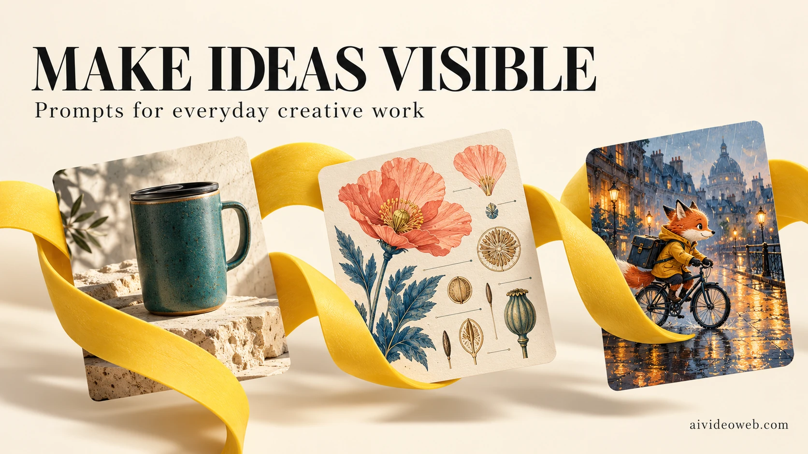

# Awesome Nano Banana 2.1 Prompts

**Original image prompts for product photography, ads, social covers, educational diagrams, portraits, storyboards and precise image editing.** Created and maintained by the **[aivideoweb.com](https://aivideoweb.com) team** as an independent open-source project.

[English](README.md) · [简体中文](README_zh.md) · [日本語](README_ja.md) · [Español](README_es.md)



**72 practical recipes · 12 categories · 2 complete prompt languages · 4 introduction languages**

Turn a creative brief into an image you can review. Every recipe includes a composition, exact text instructions, constraints, a suggested frame and a specific quality check. Choose a scenario, replace the subject, generate a draft and correct one issue at a time.

> **Preview disclosure:** The new images in this repository are illustrative generations made with the built-in imagegen tool. They are **not Nano Banana 2.1 outputs or benchmarks**. All 72 target-model recipes are currently marked `not_tested`. See the [generation manifest](assets/generation-manifest.json) for each preview's prompt and provenance. Editing recipes require your own authorized reference images.

## New: public X case workflows

**24 new bilingual adaptations** expand the initial 48 recipes to 72. Browse [source records](docs/x-case-sources.md) or filter **X case adaptations** in the gallery. Topics include garment catalogs, embroidery swaps, selective poster changes, subject continuity, multi-round lettering and texture tests.

The 8 source records include tutorials, publisher-reported demonstrations, a quoted post and a discovery thread. They are not 8 independent benchmarks or 24 verified outputs. New prompts are rewritten production briefs; their actual Nano Banana 2.1 results remain untested. Source authors, dates, inspected sections and limitations are attached to each recipe. Original media is linked rather than republished.

## Start with an actual task

| You need… | Start here | What to check |
|---|---|---|
| A clean shop image | [Ceramic travel mug](site/prompts/ceramic-travel-mug.html) | Rim, lid and contact shadow |
| A launch creative | [Coffee poster](site/prompts/coffee-launch.html) | Exact headline and glass reflections |
| A clear lesson | [Plant life cycle](site/prompts/plant-cycle.html) | Stage order and arrow direction |
| A consistent story | [Fox courier storyboard](site/prompts/fox-courier.html) | Helmet, bag and parcel across frames |
| A product scene edit | [Background replacement](site/prompts/replace-background.html) | Unchanged packaging and silhouette |
| A translated campaign | [Poster localization](site/prompts/poster-localization.html) | Accents, dates and untouched copy |

**[Browse all English prompts](prompts/en.md)** · **[查看全部中文提示词](prompts/zh.md)** · **[Open the static gallery source](site/index.html)** · **[Download structured JSON](data/prompts.json)**

The HTML gallery works locally and includes English/Chinese search, category filters, copy buttons and 72 linked detail pages. On GitHub, use the Markdown catalogs for direct reading; downloaded HTML pages need a browser or local server.

## Browse by use case

| Category | Recipes | Examples |
|---|---:|---|
| [Product photography](prompts/en.md#product-photography) | 10 | Travel mug, skincare, backpack details, jewelry |
| [Ads and branding](prompts/en.md#ads-and-branding) | 5 | Coffee launch, running club, tea packaging, bookshop |
| [Social and thumbnails](prompts/en.md#social-and-thumbnails) | 5 | Carousel, lighting thumbnail, recipe, podcast |
| [Infographics and learning](prompts/en.md#infographics-and-learning) | 4 | Plant stages, water cycle, pour-over, decision tree |
| [Portraits and people](prompts/en.md#portraits-and-people) | 9 | Avatar, cyclist, artisan, team |
| [Stories and storyboards](prompts/en.md#stories-and-storyboards) | 5 | Courier, bakery comic, film frames, character sheet |
| [Web and app concepts](prompts/en.md#web-and-app-concepts) | 5 | SaaS hero, habit app, café menu, portfolio |
| [Architecture and interiors](prompts/en.md#architecture-and-interiors) | 5 | Reading corner, courtyard, lobby, isometric studio |
| [Food and lifestyle](prompts/en.md#food-and-lifestyle) | 4 | Noodles, bakery, picnic, autumn still life |
| [Games and original assets](prompts/en.md#games-and-original-assets) | 4 | Potions, cozy shop, terrain study, creature views |
| [Editing and localization](prompts/en.md#editing-and-localization) | 11 | Background, Spanish poster, coat color, three-image composite |
| [Publishing and wide visuals](prompts/en.md#publishing-and-wide-visuals) | 5 | Book cover, banner, zine, event panorama |

## A useful prompt in five minutes

1. Open a recipe in the [English](prompts/en.md) or [Chinese](prompts/zh.md) catalog. Language versions share the same ID; translations are not counted as new scenarios.
2. Replace the fictional subject, material, palette and exact text. Keep the composition constraints that solve your task.
3. Select Nano Banana 2.1 in your tool. Configure the aspect ratio and resolution in its controls; prompt text alone does not set API parameters.
4. For an edit, upload the required images and state their roles explicitly. Do not run an edit recipe without its references.
5. Generate a small draft, inspect the recipe's quality check and request one focused correction. Use the original reference again if identity drifts.

```text
Use case: product launch poster.
Subject: an iced orange coffee, clear glass, fine condensation.
Layout: coral background, headline above, one subtitle below.
Exact text: "ORANGE HOUR" and "A brighter coffee break".
Keep: distinct ice cubes, realistic glass, readable lettering.
Avoid: extra copy, prices, unrequested objects, watermarks.
Review: check spelling, glass perspective and the contact shadow.
```

For multilingual typography, use the [localization playbook](docs/localization.md). For reference-image roles and iterative edits, see the [model guide](docs/model-guide.md).

## What is specific to Nano Banana 2.1?

This library targets `gemini-nano-banana-2.1`. Read the dated [model guide and official source](docs/model-guide.md) for capability context. The recipes put special emphasis on short exact lettering, labeled reference roles, stable character attributes and tightly scoped corrections. These are editorial techniques, not promises that every output will satisfy every constraint.

We do not claim perfect text, guaranteed identity preservation, production-ready UI code, seamless game textures or a ranking advantage over another image model. Inspect the output you receive.

## Why these recipes are different

- **Production constraints:** object counts, readable text areas, material behavior and continuity rules are written into the brief.
- **Review criteria:** “looks good” is replaced by concrete checks such as label wrapping or a character's pouch staying on the same side.
- **Honest provenance:** original text, new preview generations and pending target-model tests are recorded separately.
- **Reusable data:** stable IDs and a bilingual JSON catalog support downstream tools without scraping a README.
- **Searchable pages:** every scenario has a descriptive title, summary and static detail page. There is no fabricated usage count, review score or search ranking claim.

## Run or rebuild the gallery

Requires Python 3 for building and serving; the delivered HTML itself has no framework dependencies.

```sh
python3 scripts/build.py
python3 scripts/validate.py
python3 -m http.server 8000
```

Then open [the local gallery](http://localhost:8000/site/). Serve the **repository root**, because the gallery uses shared assets and documents from sibling directories. Clipboard access normally works on localhost; manual copying is available if the browser blocks it.

Edit `data/prompts.json`, then rebuild. Generated catalog files and pages should be committed with their data changes. See [publishing and SEO](docs/publishing.md) before deploying; the repository does not assume a live gallery URL.

## FAQ

### Are the prompts free?

The repository's original text and code are provided under the existing [MIT license](LICENSE). No paid account is required to read them. Image generation services may charge separately.

### Which languages are available?

All 72 prompts are available in English and Simplified Chinese. Japanese and Spanish have localized project introductions and starter examples. They are not complete catalog translations. The localization guide includes exact-copy examples for additional markets.

### Can I use the images commercially?

The repository includes generated illustrations, not a guarantee of exclusive ownership or third-party clearance. See the [asset notice](assets/README.md). Review your provider's terms and any visible people, brands or reference materials for your intended use.

### Why are there fewer previews than prompts?

Previews illustrate selected text-to-image recipes. A recipe without a preview is still available, but has no visual result attached. Reference-dependent edits are not demonstrated with invented input photos. Exact coverage and generation details are in the manifest.

### Does changing the model guarantee the same result?

No. A prompt is a brief, not a deterministic rendering program. The included imagegen previews do not establish how Nano Banana 2.1 will perform. Record actual model settings and outputs before making such a claim.

## Contribute and keep it useful

Read [CONTRIBUTING.md](CONTRIBUTING.md). Useful contributions include a distinct practical scenario, an accurately labeled target-model result, a reviewed translation or a documented failure case. New entries should solve a different task rather than pad counts with palette swaps.

See [content provenance](docs/provenance.md), the [editorial checklist](docs/editorial-checklist.md) and [CHANGELOG.md](CHANGELOG.md).

---

Built by the **[aivideoweb.com team](https://aivideoweb.com)**. An independent open-source collection; no affiliation with the model provider is implied.

---

## About AI VideoWeb

[**AI VideoWeb (aivideoweb.com)**](https://aivideoweb.com) is an AI video, image and music creation platform for creators and marketing teams. Explore text-to-video, image-to-video, reference-based video creation, image generation and photo editing to develop product visuals, ads and social content.

This open-source prompt library is maintained by the **aivideoweb.com team**. Start with a recipe here, adapt it to your brief, then explore the platform's [AI image tools](https://aivideoweb.com/ai-image-generator/) and video workflows.

### Affiliate partners welcome

AI VideoWeb supports **affiliate partnerships**. Creators, reviewers, educators and publishers can recommend the product through tutorials, reviews and community content. See the [**AI VideoWeb Affiliate Program — join and view current terms**](https://aivideoweb.com/affiliate-program/).
