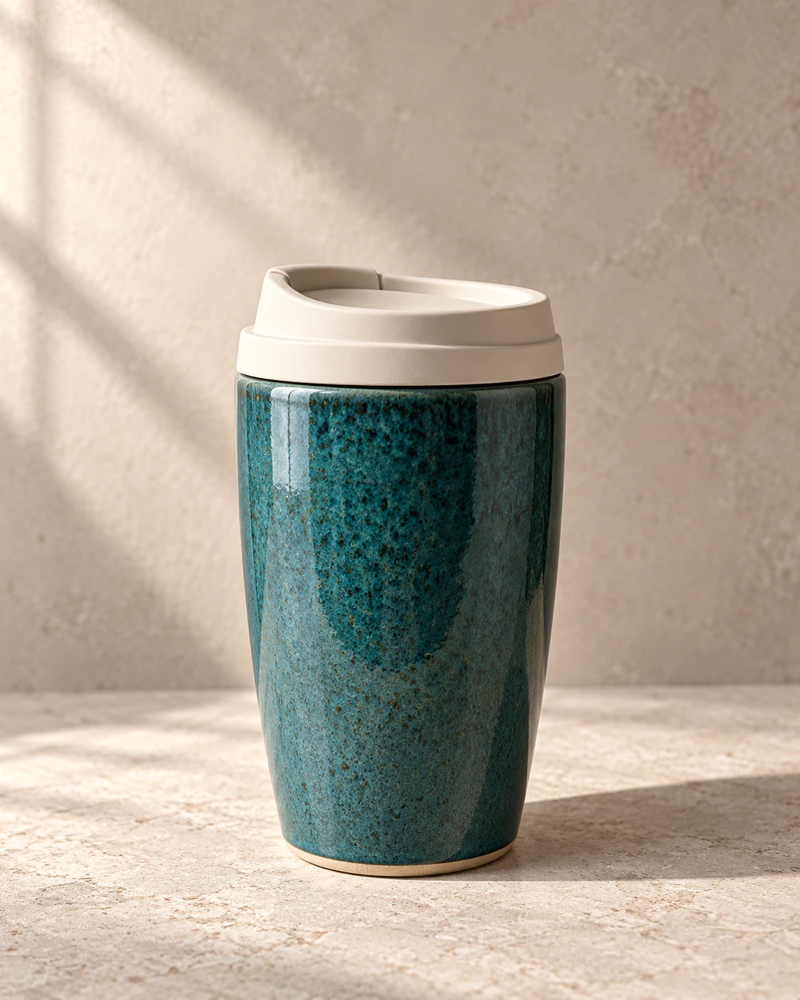
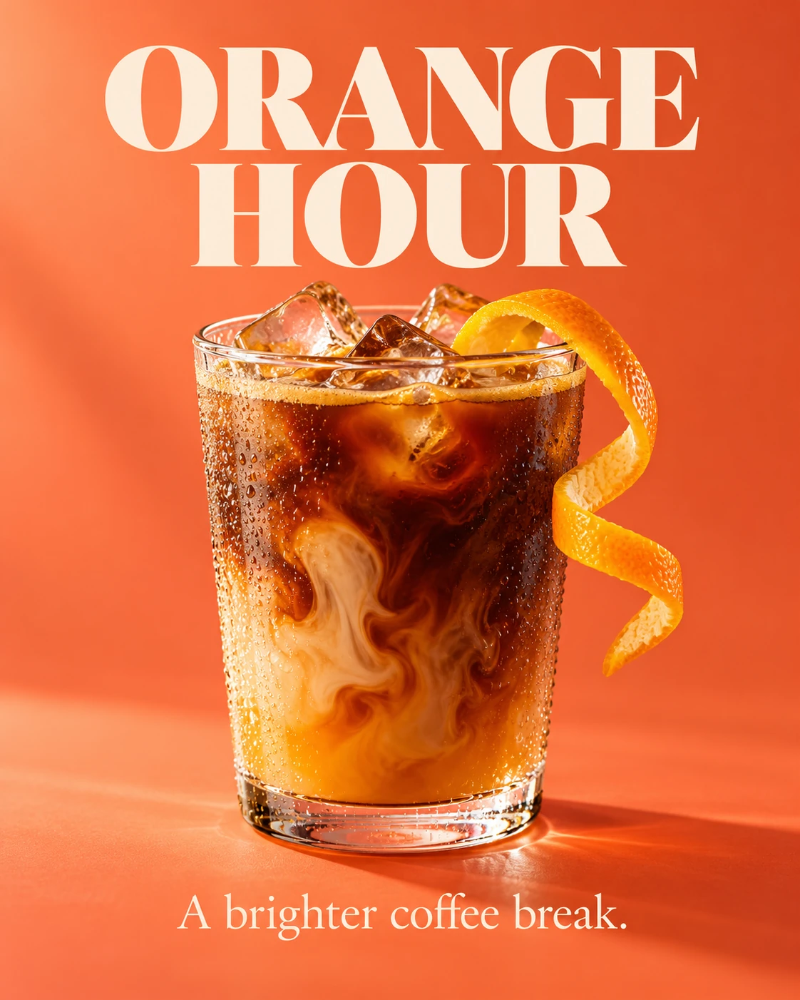
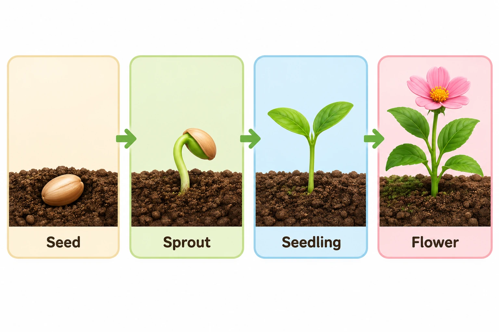
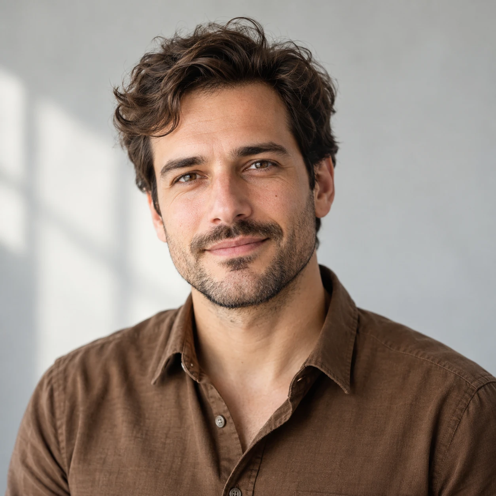
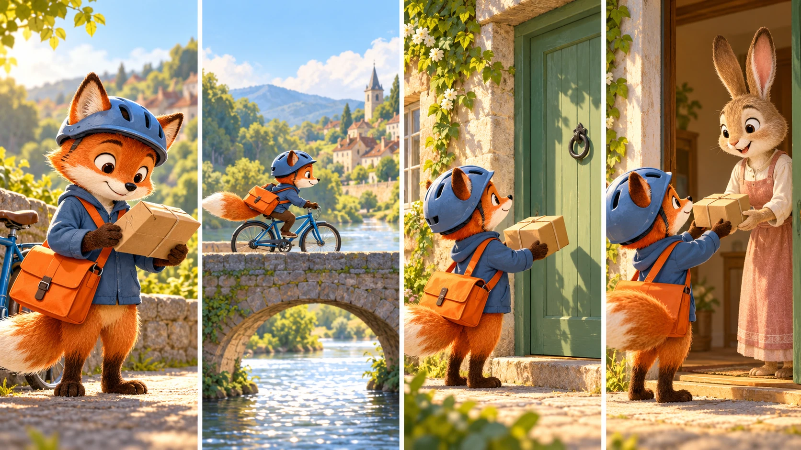
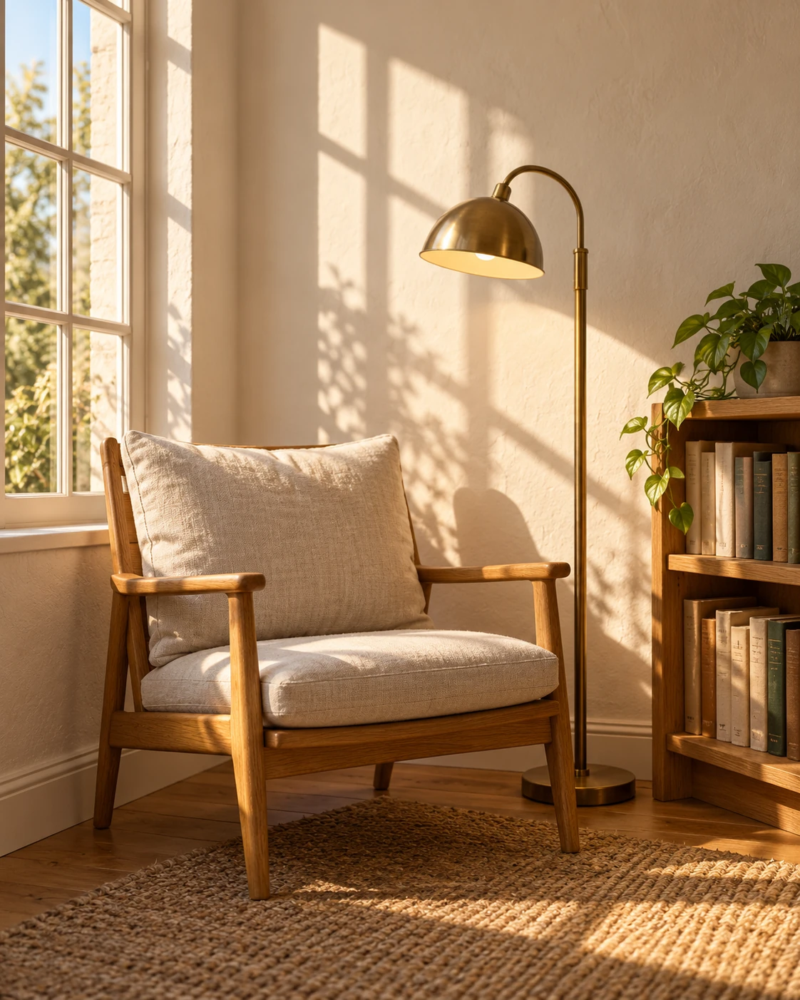
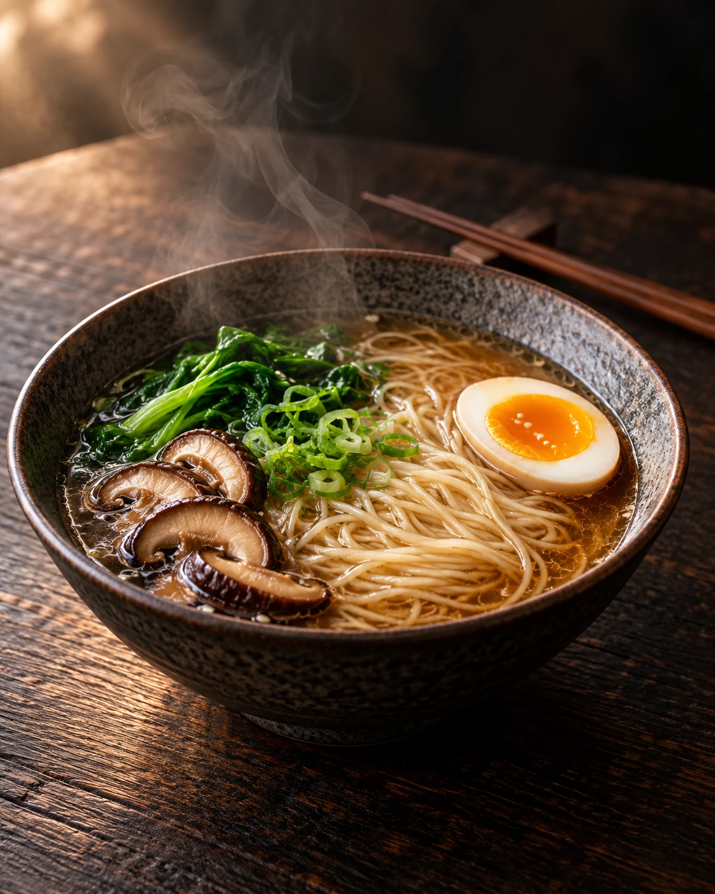
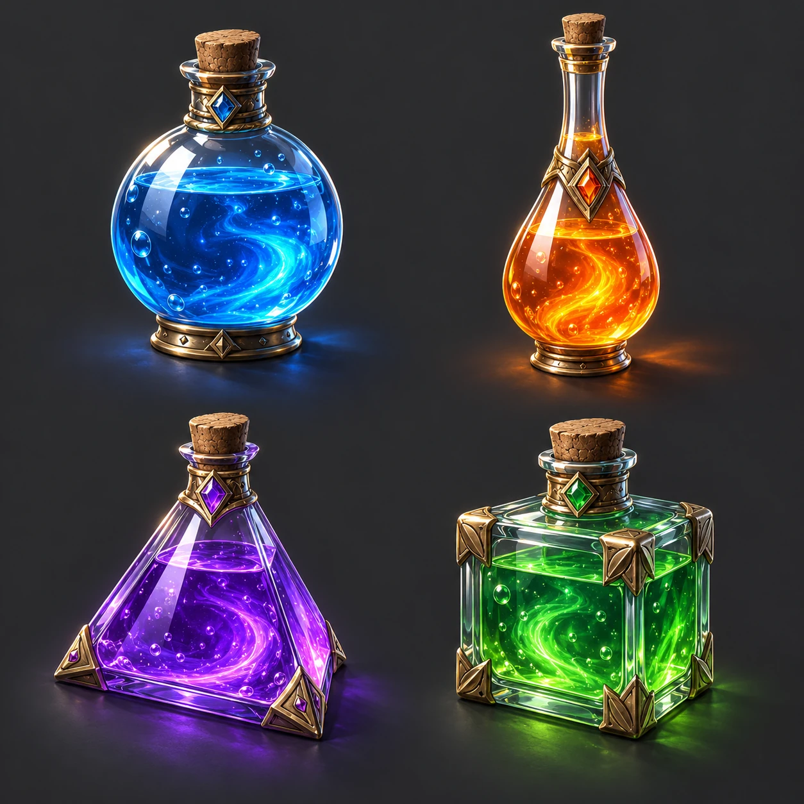
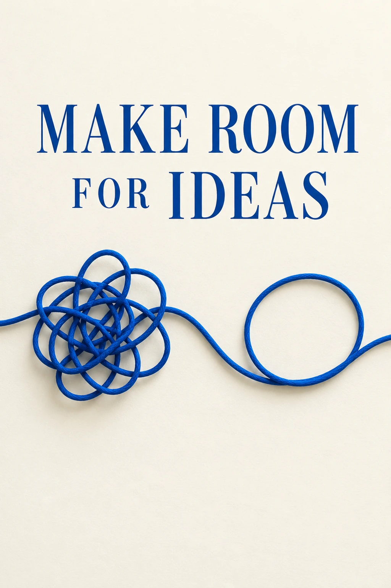

# Nano Banana 2.1 提示词完整目录

[aivideoweb.com](https://aivideoweb.com) · [Home](../README.md) · [JSON](../data/prompts.json)

72 条制作方案，其中 24 条根据公开 X 案例主题改编。中英文为同一条目的两种语言版本，不重复计数。所有改编均未独立复现。

## 电商与产品摄影

### NB001 · 陶瓷随行杯主图

`generate` · `4:5` · 无需参考图



新生成的说明性展示图；由内置 imagegen 工具生成，非 Nano Banana 2.1 实测。

```text
用途：陶瓷随行杯主图。目标画幅：4:5。
一只青绿色陶瓷随行杯放在暖灰石灰岩台面，杯盖为哑光奶油白；右侧有一片柔和的弧形阴影，左上方自然窗光，保留细微釉面颗粒，产品占画面高度65%，上方留出20%文案区。
文字要求：无文字。除指定文字外不添加任何文字、水印或签名。
构图保持清晰层级、合理留白和统一光源。不要添加未要求的物件。输出单张完成图。
```

**验收：** 检查杯口椭圆、盖子接缝和接触阴影。

**单点修正：** 仅修正上述验收中不合格的部分，保持主体、构图、色调和其他文字不变。

**模型建议：** 先选 1K 验证构图，再按用途选 2K/4K；画幅和分辨率在客户端设置，不依赖提示词文字。编辑类先上传参考图。

### NB002 · 护肤套装俯拍

`generate` · `1:1` · 无需参考图

```text
用途：护肤套装俯拍。目标画幅：1:1。
三件虚构品牌护肤容器：磨砂玻璃滴管瓶、白色软管、矮圆罐；在淡杏色纸面上形成疏松三角形，右上角一滴透明凝胶，每个容器之间至少留出一个瓶盖宽的距离。
文字要求：仅瓶身标签：NOMA。除指定文字外不添加任何文字、水印或签名。
构图保持清晰层级、合理留白和统一光源。不要添加未要求的物件。输出单张完成图。
```

**验收：** 三个容器不能融合，标签应贴合曲面。

**单点修正：** 仅修正上述验收中不合格的部分，保持主体、构图、色调和其他文字不变。

**模型建议：** 先选 1K 验证构图，再按用途选 2K/4K；画幅和分辨率在客户端设置，不依赖提示词文字。编辑类先上传参考图。

### NB003 · 背包功能细节

`generate` · `3:2` · 无需参考图

```text
用途：背包功能细节。目标画幅：3:2。
橄榄绿城市背包放在木凳上，侧袋插入金属水壶；画面右侧设置两个独立放大窗口，分别展示拉链齿和肩带编织纹理，用细线指向实际部位。
文字要求：无文字。除指定文字外不添加任何文字、水印或签名。
构图保持清晰层级、合理留白和统一光源。不要添加未要求的物件。输出单张完成图。
```

**验收：** 放大窗口必须对应原物，不能虚构额外口袋。

**单点修正：** 仅修正上述验收中不合格的部分，保持主体、构图、色调和其他文字不变。

**模型建议：** 先选 1K 验证构图，再按用途选 2K/4K；画幅和分辨率在客户端设置，不依赖提示词文字。编辑类先上传参考图。

### NB004 · 银饰微距

`generate` · `1:1` · 无需参考图

```text
用途：银饰微距。目标画幅：1:1。
一枚不规则锤纹银戒指竖立于深蓝棉纸上，单一窄条柔光形成连续高光，浅景深但戒指外轮廓完整清晰；避免高光溢出导致金属变成白色塑料。
文字要求：无文字。除指定文字外不添加任何文字、水印或签名。
构图保持清晰层级、合理留白和统一光源。不要添加未要求的物件。输出单张完成图。
```

**验收：** 戒圈应闭合，内外反射方向一致。

**单点修正：** 仅修正上述验收中不合格的部分，保持主体、构图、色调和其他文字不变。

**模型建议：** 先选 1K 验证构图，再按用途选 2K/4K；画幅和分辨率在客户端设置，不依赖提示词文字。编辑类先上传参考图。

### NB049 · 服装目录：统一正面主图

`edit` · `2:3` · 需上传自有/获授权参考图

**X 案例来源（社区报告，未独立复现）**

- [Muhammad Ayan · How to Shoot a Full Product Catalog With Nano Banana 2.1 (Full Guide)](https://x.com/socialwithaayan/article/2107789352252350546) · 2026-10-07 · Step 1–2: house shot and front

aivideoweb.com团队依据公开案例主题重新设计主体、构图和检查点；非原帖提示词逐字转载，未下载原图，尚未独立复现。

```text
用途：服装目录：统一正面主图。建议画幅：2:3，请在客户端设置。
图1为获授权的真实夹克正面照片；图2为本目录批准的摄影基准，只提供衣架、背景和光线。将图1夹克正面朝向镜头，挂在图2的深色扁木衣架上，居中于浅灰背景。使用相同机位和柔光，衣服下摆距画底约15%。保留口袋、扣子、面料、颜色和原有标识，不添加文字或配饰。
输出单张完成图；多轮或系列任务按步骤分别运行，不能自行合并。
```

**验收：** 与真实正面核对口袋位置、扣子数量、袖长；再对比基准图衣架角度和留白。

**单点修正：** 仅修正上述验收中不合格的部分，保持主体、构图、色调和其他文字不变。

**模型建议：** 先选 1K 验证构图，再按用途选 2K/4K；画幅和分辨率在客户端设置，不依赖提示词文字。编辑类先上传参考图。

### NB050 · 服装目录：有实物依据的背面

`edit` · `2:3` · 需上传自有/获授权参考图

**X 案例来源（社区报告，未独立复现）**

- [Muhammad Ayan · How to Shoot a Full Product Catalog With Nano Banana 2.1 (Full Guide)](https://x.com/socialwithaayan/article/2107789352252350546) · 2026-10-07 · Step 3: back view and its caveat

aivideoweb.com团队依据公开案例主题重新设计主体、构图和检查点；非原帖提示词逐字转载，未下载原图，尚未独立复现。

```text
用途：服装目录：有实物依据的背面。建议画幅：2:3，请在客户端设置。
图1必须是同一件衣服的真实背面照片，图2是已批准的正面目录图，仅参考摄影设置。基于图1重拍背面，沿用图2的背景、衣架、机位和阴影柔度。准确保留背面拼接、褶皱结构、图案与标签。若没有背面参考，不猜测背印或结构，停止并要求补图。无新增文字。
输出单张完成图；多轮或系列任务按步骤分别运行，不能自行合并。
```

**验收：** 背面图案必须来自真实背面，不能把正面口袋复制到背面。

**单点修正：** 仅修正上述验收中不合格的部分，保持主体、构图、色调和其他文字不变。

**模型建议：** 先选 1K 验证构图，再按用途选 2K/4K；画幅和分辨率在客户端设置，不依赖提示词文字。编辑类先上传参考图。

### NB051 · 服装目录：双参考上身图

`edit` · `2:3` · 需上传自有/获授权参考图

**X 案例来源（社区报告，未独立复现）**

- [Muhammad Ayan · How to Shoot a Full Product Catalog With Nano Banana 2.1 (Full Guide)](https://x.com/socialwithaayan/article/2107789352252350546) · 2026-10-07 · Step 4: garment and model references

aivideoweb.com团队依据公开案例主题重新设计主体、构图和检查点；非原帖提示词逐字转载，未下载原图，尚未独立复现。

```text
用途：服装目录：双参考上身图。建议画幅：2:3，请在客户端设置。
图1提供真实服装身份，图2提供经授权的成年模特身份。让图2人物在柔光浅灰摄影棚中穿图1服装，全身三分之四视角，双臂自然下垂，不遮挡门襟。用炭灰长裤和素色帆布鞋作为配搭。保持人物脸型、发型及肤色，服装的领口、扣位、口袋和长度不得重设计。无新增文字。
输出单张完成图；多轮或系列任务按步骤分别运行，不能自行合并。
```

**验收：** 分别核对模特身份与衣服结构，袖口不能与手指融合。

**单点修正：** 仅修正上述验收中不合格的部分，保持主体、构图、色调和其他文字不变。

**模型建议：** 先选 1K 验证构图，再按用途选 2K/4K；画幅和分辨率在客户端设置，不依赖提示词文字。编辑类先上传参考图。

### NB052 · 服装目录：比例可信的平铺图

`edit` · `4:5` · 需上传自有/获授权参考图

**X 案例来源（社区报告，未独立复现）**

- [Muhammad Ayan · How to Shoot a Full Product Catalog With Nano Banana 2.1 (Full Guide)](https://x.com/socialwithaayan/article/2107789352252350546) · 2026-10-07 · Step 5: flat lays

aivideoweb.com团队依据公开案例主题重新设计主体、构图和检查点；非原帖提示词逐字转载，未下载原图，尚未独立复现。

```text
用途：服装目录：比例可信的平铺图。建议画幅：4:5，请在客户端设置。
图1为真实针织上衣。将同一件上衣平铺在浅灰棉布上，用正上方镜头拍摄，袖子自然伸展。右上放一个无品牌小收纳袋，不能遮挡领口和衣摆；四边留等宽安全区。保持原针织密度、纹样、领型与颜色，不能用配件让衣服显得比实物更大。无文字。
输出单张完成图；多轮或系列任务按步骤分别运行，不能自行合并。
```

**验收：** 俯视透视、袖长、图案位置及针织密度应与参考一致。

**单点修正：** 仅修正上述验收中不合格的部分，保持主体、构图、色调和其他文字不变。

**模型建议：** 先选 1K 验证构图，再按用途选 2K/4K；画幅和分辨率在客户端设置，不依赖提示词文字。编辑类先上传参考图。

### NB053 · 服装目录：可核对的缝线细节

`edit` · `1:1` · 需上传自有/获授权参考图

**X 案例来源（社区报告，未独立复现）**

- [Muhammad Ayan · How to Shoot a Full Product Catalog With Nano Banana 2.1 (Full Guide)](https://x.com/socialwithaayan/article/2107789352252350546) · 2026-10-07 · Step 5–6: detail and comparison

aivideoweb.com团队依据公开案例主题重新设计主体、构图和检查点；非原帖提示词逐字转载，未下载原图，尚未独立复现。

```text
用途：服装目录：可核对的缝线细节。建议画幅：1:1，请在客户端设置。
图1为获授权服装照片，图2为该服装真实袖口微距。以图2为事实依据，生成袖口、纽扣和双道明线的近景，柔和掠射光突出纤维，不改变线迹间距或扣眼形状。背景仅保留同一面料虚化区域。不得把参考图看不清的护理文字补写出来，不新增标识。
输出单张完成图；多轮或系列任务按步骤分别运行，不能自行合并。
```

**验收：** 扣孔、线迹和布料纹理必须有参考依据；不能把补绘细节当商品实拍。

**单点修正：** 仅修正上述验收中不合格的部分，保持主体、构图、色调和其他文字不变。

**模型建议：** 先选 1K 验证构图，再按用途选 2K/4K；画幅和分辨率在客户端设置，不依赖提示词文字。编辑类先上传参考图。

### NB069 · 同一电脑的跨场景产品系列

`edit` · `3:2` · 需上传自有/获授权参考图

**X 案例来源（社区报告，未独立复现）**

- [Julian Goldie SEO · 5 Prompts to Test Google Flow Character Consistency](https://x.com/JulianGoldieSEO/article/2109707716503740878) · 2026-10-12 · Prompt Five: laptop series

aivideoweb.com团队依据公开案例主题重新设计主体、构图和检查点；非原帖提示词逐字转载，未下载原图，尚未独立复现。

```text
用途：同一电脑的跨场景产品系列。建议画幅：3:2，请在客户端设置。
图1为自有笔记本电脑产品照片，明确其键盘、接口、屏幕边框和铰链。基于同一参考分别生成三张独立图：白色工作台、木质书桌、深灰摄影棚。每次保持相同开合角度、镜头、占位及外观，只换背景与对应反光。屏幕为无字柔和渐变，不虚构新接口、商标或系统界面。一次运行只做一个场景。
输出单张完成图；多轮或系列任务按步骤分别运行，不能自行合并。
```

**验收：** 三张逐项核对接口、铰链与键盘，不能只比较外壳颜色。

**单点修正：** 仅修正上述验收中不合格的部分，保持主体、构图、色调和其他文字不变。

**模型建议：** 先选 1K 验证构图，再按用途选 2K/4K；画幅和分辨率在客户端设置，不依赖提示词文字。编辑类先上传参考图。

## 广告与品牌视觉

### NB005 · 咖啡新品海报

`generate` · `4:5` · 无需参考图



新生成的说明性展示图；由内置 imagegen 工具生成，非 Nano Banana 2.1 实测。

```text
用途：咖啡新品海报。目标画幅：4:5。
一杯冰橙咖啡在珊瑚橙背景前，透明玻璃杯凝有细小水珠，橙皮卷形成引导线，冰块数量适中；上方大标题，下方单行副标题，不添加价格或促销承诺。
文字要求：标题：ORANGE HOUR；副标题：A brighter coffee break。除指定文字外不添加任何文字、水印或签名。
构图保持清晰层级、合理留白和统一光源。不要添加未要求的物件。输出单张完成图。
```

**验收：** 检查字母拼写、冰块透视和杯底阴影。

**单点修正：** 仅修正上述验收中不合格的部分，保持主体、构图、色调和其他文字不变。

**模型建议：** 先选 1K 验证构图，再按用途选 2K/4K；画幅和分辨率在客户端设置，不依赖提示词文字。编辑类先上传参考图。

### NB006 · 跑步社群招募

`generate` · `9:16` · 无需参考图

```text
用途：跑步社群招募。目标画幅：9:16。
清晨河畔，三位不同体型的成年跑者以轻松配速向右跑，反光背心有合理织物细节；下半部留出干净雾蓝渐变，排版像独立社区活动宣传。
文字要求：RUN TOGETHER；SATURDAY 07:00。除指定文字外不添加任何文字、水印或签名。
构图保持清晰层级、合理留白和统一光源。不要添加未要求的物件。输出单张完成图。
```

**验收：** 三位人物肢体分离，时间只出现一次。

**单点修正：** 仅修正上述验收中不合格的部分，保持主体、构图、色调和其他文字不变。

**模型建议：** 先选 1K 验证构图，再按用途选 2K/4K；画幅和分辨率在客户端设置，不依赖提示词文字。编辑类先上传参考图。

### NB007 · 茶叶包装概念

`generate` · `3:2` · 无需参考图

```text
用途：茶叶包装概念。目标画幅：3:2。
虚构乌龙茶品牌的纸盒、茶罐和封口贴，米白与墨绿双色，抽象山脊压纹；三件包装置于同一桌面，用平视三分之四视角展示，包装不冒充已上市产品。
文字要求：RIDGE TEA；OOLONG。除指定文字外不添加任何文字、水印或签名。
构图保持清晰层级、合理留白和统一光源。不要添加未要求的物件。输出单张完成图。
```

**验收：** 检查品牌名统一、盒子透视和罐盖结构。

**单点修正：** 仅修正上述验收中不合格的部分，保持主体、构图、色调和其他文字不变。

**模型建议：** 先选 1K 验证构图，再按用途选 2K/4K；画幅和分辨率在客户端设置，不依赖提示词文字。编辑类先上传参考图。

### NB008 · 独立书店开业

`generate` · `4:5` · 无需参考图

```text
用途：独立书店开业。目标画幅：4:5。
奶油色底上的编辑式书店海报，中心为一扇暖黄灯光的蓝色小门，两侧堆叠不同高度的书；保留纸张纹理，标题采用深蓝粗体，装饰元素少于五个。
文字要求：TURN A PAGE；OPENING WEEKEND。除指定文字外不添加任何文字、水印或签名。
构图保持清晰层级、合理留白和统一光源。不要添加未要求的物件。输出单张完成图。
```

**验收：** 标题可读，书脊不要生成伪作者名字。

**单点修正：** 仅修正上述验收中不合格的部分，保持主体、构图、色调和其他文字不变。

**模型建议：** 先选 1K 验证构图，再按用途选 2K/4K；画幅和分辨率在客户端设置，不依赖提示词文字。编辑类先上传参考图。

### NB064 · 招牌文字的两轮连续编辑

`edit` · `16:9` · 需上传自有/获授权参考图

**X 案例来源（社区报告，未独立复现）**

- [Michael Aubry · Nano Banana 2.1 is 2x faster than GPT Image 2.5. Here's when that matters.](https://x.com/michaelaubry/article/2107900126920609795) · 2026-10-07 · What Google says changed: cafe sign edits

aivideoweb.com团队依据公开案例主题重新设计主体、构图和检查点；非原帖提示词逐字转载，未下载原图，尚未独立复现。

```text
用途：招牌文字的两轮连续编辑。建议画幅：16:9，请在客户端设置。
图1为自有咖啡馆白天外观，窗内招牌准确写着“OPEN STUDIO”和“MAKE SOMETHING”。第一轮仅改为傍晚小雨，保持招牌字形、建筑、构图与相机位置。确认两行文字无误后，第二轮以合格结果为参考，只将招牌照明改为暖白背光，不改文案或排版。每轮分别输出并保存，禁止合并成一张前后拼图。
输出单张完成图；多轮或系列任务按步骤分别运行，不能自行合并。
```

**验收：** 两轮均逐字对比招牌，再检查窗框和雨夜光线；不是一次成功就证明多轮稳定。

**单点修正：** 仅修正上述验收中不合格的部分，保持主体、构图、色调和其他文字不变。

**模型建议：** 先选 1K 验证构图，再按用途选 2K/4K；画幅和分辨率在客户端设置，不依赖提示词文字。编辑类先上传参考图。

## 社交内容与封面

### NB009 · 桌面整理轮播

`generate` · `4:5` · 无需参考图


新生成的说明性展示图；由内置 imagegen 工具生成，非 Nano Banana 2.1 实测。

```text
用途：桌面整理轮播。目标画幅：4:5。
俯拍真实居家工作桌，左侧只有键盘、笔记本和一杯水，右侧放三个整齐收纳盒，采用燕麦色与鼠尾草绿，标题位于顶部空白纸片上。
文字要求：RESET YOUR DESK。除指定文字外不添加任何文字、水印或签名。
构图保持清晰层级、合理留白和统一光源。不要添加未要求的物件。输出单张完成图。
```

**验收：** 避免把收纳视觉包装成真实效果对比。

**单点修正：** 仅修正上述验收中不合格的部分，保持主体、构图、色调和其他文字不变。

**模型建议：** 先选 1K 验证构图，再按用途选 2K/4K；画幅和分辨率在客户端设置，不依赖提示词文字。编辑类先上传参考图。

### NB010 · 摄影灯光视频缩略图

`generate` · `16:9` · 无需参考图

```text
用途：摄影灯光视频缩略图。目标画幅：16:9。
同一位虚构成年摄影师在同一构图内左右对照，左半为平淡顶光，右半为柔和侧光；两侧面部、服饰和表情相同，中间用细竖线分割，背景为深灰摄影棚。
文字要求：ONE LIGHT。除指定文字外不添加任何文字、水印或签名。
构图保持清晰层级、合理留白和统一光源。不要添加未要求的物件。输出单张完成图。
```

**验收：** 只改变光线，不能把不同人物当成前后对比。

**单点修正：** 仅修正上述验收中不合格的部分，保持主体、构图、色调和其他文字不变。

**模型建议：** 先选 1K 验证构图，再按用途选 2K/4K；画幅和分辨率在客户端设置，不依赖提示词文字。编辑类先上传参考图。

### NB011 · 早餐食谱卡

`generate` · `4:5` · 无需参考图

```text
用途：早餐食谱卡。目标画幅：4:5。
编辑式早餐卡片，上半为酸奶燕麦碗的顶视摄影，下半为三条短步骤，碗里有蓝莓、香蕉片和南瓜籽；勺子放在右侧，不遮挡文字。
文字要求：MORNING BOWL；1. Add yogurt；2. Layer oats；3. Top with fruit。除指定文字外不添加任何文字、水印或签名。
构图保持清晰层级、合理留白和统一光源。不要添加未要求的物件。输出单张完成图。
```

**验收：** 顺序准确，不能添加营养或减重承诺。

**单点修正：** 仅修正上述验收中不合格的部分，保持主体、构图、色调和其他文字不变。

**模型建议：** 先选 1K 验证构图，再按用途选 2K/4K；画幅和分辨率在客户端设置，不依赖提示词文字。编辑类先上传参考图。

### NB012 · 播客封面

`generate` · `1:1` · 无需参考图

```text
用途：播客封面。目标画幅：1:1。
抽象奶油色圆形声波围绕一颗赤陶色球体，在深紫背景上营造安静夜谈气氛；采用两级排版，缩小至手机封面仍能辨认标题。
文字要求：AFTER HOURS；Small conversations, wider ideas。除指定文字外不添加任何文字、水印或签名。
构图保持清晰层级、合理留白和统一光源。不要添加未要求的物件。输出单张完成图。
```

**验收：** 检查缩略图辨识度，文字不要绕球弯曲。

**单点修正：** 仅修正上述验收中不合格的部分，保持主体、构图、色调和其他文字不变。

**模型建议：** 先选 1K 验证构图，再按用途选 2K/4K；画幅和分辨率在客户端设置，不依赖提示词文字。编辑类先上传参考图。

### NB067 · 同角色舞台教学缩略图

`edit` · `16:9` · 需上传自有/获授权参考图

**X 案例来源（社区报告，未独立复现）**

- [Julian Goldie SEO · 5 Prompts to Test Google Flow Character Consistency](https://x.com/JulianGoldieSEO/article/2109707716503740878) · 2026-10-12 · Prompt Three: teaching on stage

aivideoweb.com团队依据公开案例主题重新设计主体、构图和检查点；非原帖提示词逐字转载，未下载原图，尚未独立复现。

```text
用途：同角色舞台教学缩略图。建议画幅：16:9，请在客户端设置。
图1为同一虚构成年引导角色基准。让角色站在小型社区讲座舞台右侧，后方为无文字浅蓝屏幕，前景只有三位虚化成年听众的后脑轮廓。保留面部比例、发型、眼镜、苔绿夹克和右衣领铜扣。左侧保留40%整洁标题区但不画字；照明自然，不添加品牌、演讲名或虚构活动标识。
输出单张完成图；多轮或系列任务按步骤分别运行，不能自行合并。
```

**验收：** 与基准核对脸和领扣，舞台灯不能把衣服变成另一种颜色。

**单点修正：** 仅修正上述验收中不合格的部分，保持主体、构图、色调和其他文字不变。

**模型建议：** 先选 1K 验证构图，再按用途选 2K/4K；画幅和分辨率在客户端设置，不依赖提示词文字。编辑类先上传参考图。

## 信息图与教育

### NB013 · 植物生长课堂图

`generate` · `3:2` · 无需参考图



新生成的说明性展示图；由内置 imagegen 工具生成，非 Nano Banana 2.1 实测。

```text
用途：植物生长课堂图。目标画幅：3:2。
儿童课堂用的四阶段植物生长图，从左到右为种子、萌芽、幼苗和开花；每个阶段独立置于相同大小的圆角框内，土壤线对齐，用单向箭头串联，白底柔和配色。
文字要求：Seed；Sprout；Seedling；Flower。除指定文字外不添加任何文字、水印或签名。
构图保持清晰层级、合理留白和统一光源。不要添加未要求的物件。输出单张完成图。
```

**验收：** 顺序与标签一一对应，不把根画在土壤上方。

**单点修正：** 仅修正上述验收中不合格的部分，保持主体、构图、色调和其他文字不变。

**模型建议：** 先选 1K 验证构图，再按用途选 2K/4K；画幅和分辨率在客户端设置，不依赖提示词文字。编辑类先上传参考图。

### NB014 · 简化水循环

`generate` · `16:9` · 无需参考图

```text
用途：简化水循环。目标画幅：16:9。
面向小学的简化水循环剖面图，左侧海洋、右侧山地，中间云团；只画三条清晰箭头：海面向上、云向山地下雨、河流回海，图形平面化，背景干净。
文字要求：Evaporation；Precipitation；Collection。除指定文字外不添加任何文字、水印或签名。
构图保持清晰层级、合理留白和统一光源。不要添加未要求的物件。输出单张完成图。
```

**验收：** 这是简化教学图；校对箭头，避免逆向河流。

**单点修正：** 仅修正上述验收中不合格的部分，保持主体、构图、色调和其他文字不变。

**模型建议：** 先选 1K 验证构图，再按用途选 2K/4K；画幅和分辨率在客户端设置，不依赖提示词文字。编辑类先上传参考图。

### NB015 · 手冲咖啡步骤图

`generate` · `4:5` · 无需参考图

```text
用途：手冲咖啡步骤图。目标画幅：4:5。
纵向四步手冲咖啡示意，每步一张独立小插图：放滤纸、加入咖啡粉、缓慢注水、移走滤杯；米白底和棕色线条，步骤之间留足空间。
文字要求：1 FILTER；2 GROUNDS；3 POUR；4 SERVE。除指定文字外不添加任何文字、水印或签名。
构图保持清晰层级、合理留白和统一光源。不要添加未要求的物件。输出单张完成图。
```

**验收：** 滤杯、壶和杯子的结构在四步中一致。

**单点修正：** 仅修正上述验收中不合格的部分，保持主体、构图、色调和其他文字不变。

**模型建议：** 先选 1K 验证构图，再按用途选 2K/4K；画幅和分辨率在客户端设置，不依赖提示词文字。编辑类先上传参考图。

### NB016 · 文件整理决策树

`generate` · `16:9` · 无需参考图

```text
用途：文件整理决策树。目标画幅：16:9。
只包含五个节点的流程图：顶部问题节点，左侧保留节点与归档节点，右侧删除候选节点与人工复核节点；深蓝线条、白色卡片、浅灰底，连接线不得交叉。
文字要求：NEEDED?；KEEP；ARCHIVE；DELETE CANDIDATE；REVIEW。除指定文字外不添加任何文字、水印或签名。
构图保持清晰层级、合理留白和统一光源。不要添加未要求的物件。输出单张完成图。
```

**验收：** 从NEEDED?连接KEEP与DELETE CANDIDATE，KEEP连接ARCHIVE，DELETE CANDIDATE连接REVIEW；不暗示自动删除。

**单点修正：** 仅修正上述验收中不合格的部分，保持主体、构图、色调和其他文字不变。

**模型建议：** 先选 1K 验证构图，再按用途选 2K/4K；画幅和分辨率在客户端设置，不依赖提示词文字。编辑类先上传参考图。

## 头像与人物摄影

### NB017 · 自然职业头像

`generate` · `1:1` · 无需参考图



新生成的说明性展示图；由内置 imagegen 工具生成，非 Nano Banana 2.1 实测。

```text
用途：自然职业头像。目标画幅：1:1。
一位虚构成年建筑设计师的肩部以上头像，棕色棉衬衫、温和自然表情，背景为虚化浅灰墙，眼睛清晰，保留肤质和自然不对称，柔和窗光。
文字要求：无文字。除指定文字外不添加任何文字、水印或签名。
构图保持清晰层级、合理留白和统一光源。不要添加未要求的物件。输出单张完成图。
```

**验收：** 不磨皮成塑料，不添加证件或公司标志。

**单点修正：** 仅修正上述验收中不合格的部分，保持主体、构图、色调和其他文字不变。

**模型建议：** 先选 1K 验证构图，再按用途选 2K/4K；画幅和分辨率在客户端设置，不依赖提示词文字。编辑类先上传参考图。

### NB018 · 雨夜环境人像

`generate` · `2:3` · 无需参考图

```text
用途：雨夜环境人像。目标画幅：2:3。
成年骑行者站在雨后路边咖啡馆屋檐下，芥末黄色雨衣、湿润自行车车把，远处琥珀色灯光虚化；人物面部接受柔和环境光，不做夸张霓虹。
文字要求：无文字。除指定文字外不添加任何文字、水印或签名。
构图保持清晰层级、合理留白和统一光源。不要添加未要求的物件。输出单张完成图。
```

**验收：** 手指自然握把，雨衣和地面湿润程度一致。

**单点修正：** 仅修正上述验收中不合格的部分，保持主体、构图、色调和其他文字不变。

**模型建议：** 先选 1K 验证构图，再按用途选 2K/4K；画幅和分辨率在客户端设置，不依赖提示词文字。编辑类先上传参考图。

### NB019 · 手艺人品牌肖像

`generate` · `4:5` · 无需参考图

```text
用途：手艺人品牌肖像。目标画幅：4:5。
一位虚构成年陶艺师在工作室修整半干陶碗，手和工具清楚，人物偏左，右侧留自然暗部作采访引文区域，木架上只有少量陶器。
文字要求：无文字。除指定文字外不添加任何文字、水印或签名。
构图保持清晰层级、合理留白和统一光源。不要添加未要求的物件。输出单张完成图。
```

**验收：** 工具接触陶碗的位置合理，保留手部泥痕。

**单点修正：** 仅修正上述验收中不合格的部分，保持主体、构图、色调和其他文字不变。

**模型建议：** 先选 1K 验证构图，再按用途选 2K/4K；画幅和分辨率在客户端设置，不依赖提示词文字。编辑类先上传参考图。

### NB020 · 小团队合照

`generate` · `16:9` · 无需参考图

```text
用途：小团队合照。目标画幅：16:9。
四位虚构成年创作者围坐明亮共享工作室，桌上放纸质草图和两台合上的电脑；坐姿自然且互不遮挡，每个人服饰颜色不同，像真实编辑采访照片。
文字要求：无文字。除指定文字外不添加任何文字、水印或签名。
构图保持清晰层级、合理留白和统一光源。不要添加未要求的物件。输出单张完成图。
```

**验收：** 四张脸各不相同，桌面不能穿过身体。

**单点修正：** 仅修正上述验收中不合格的部分，保持主体、构图、色调和其他文字不变。

**模型建议：** 先选 1K 验证构图，再按用途选 2K/4K；画幅和分辨率在客户端设置，不依赖提示词文字。编辑类先上传参考图。

### NB059 · 厨房产品UGC自然人像

`generate` · `9:16` · 无需参考图

**X 案例来源（社区报告，未独立复现）**

- [Michael Aubry · Nano Banana 2.1 is 2x faster than GPT Image 2.5. Here's when that matters.](https://x.com/michaelaubry/article/2107900126920609795) · 2026-10-07 · Kitchen selfie, same words

aivideoweb.com团队依据公开案例主题重新设计主体、构图和检查点；非原帖提示词逐字转载，未下载原图，尚未独立复现。

```text
用途：厨房产品UGC自然人像。建议画幅：9:16，请在客户端设置。
生成一位虚构成年烘焙创作者的日常手机照片，站在朴素明亮的家用厨房，穿棕红棉质上衣，手持无品牌乳白按压瓶，瓶身正面朝向镜头且不遮挡脸。保留自然皮肤纹理、细微发丝和真实窗光，轻微手持构图但不做鱼眼畸变。不是实际用户证言，不添加效果对比、文字、标志或水印。
输出单张完成图；多轮或系列任务按步骤分别运行，不能自行合并。
```

**验收：** 手指、瓶嘴与镜面方向可信；不得把虚构人物作为真实客户背书。

**单点修正：** 仅修正上述验收中不合格的部分，保持主体、构图、色调和其他文字不变。

**模型建议：** 先选 1K 验证构图，再按用途选 2K/4K；画幅和分辨率在客户端设置，不依赖提示词文字。编辑类先上传参考图。

### NB060 · 健身镜自拍：反射几何检查

`generate` · `9:16` · 无需参考图

**X 案例来源（社区报告，未独立复现）**

- [Michael Aubry · Nano Banana 2.1 is 2x faster than GPT Image 2.5. Here's when that matters.](https://x.com/michaelaubry/article/2107900126920609795) · 2026-10-07 · How I tested: gym mirror selfie

aivideoweb.com团队依据公开案例主题重新设计主体、构图和检查点；非原帖提示词逐字转载，未下载原图，尚未独立复现。

```text
用途：健身镜自拍：反射几何检查。建议画幅：9:16，请在客户端设置。
一位虚构成年运动爱好者在安静健身房镜前拍照，宽松灰色运动衫、深蓝长裤，手机仅部分遮挡面部。画面只出现一面镜子及同一人物的一次镜中反射；背景器械简单且无人。柔和顶部漫射光，普通手机色彩，无品牌、文字或夸张身体修饰。不要生成第二个现实人物或镜中额外手机。
输出单张完成图；多轮或系列任务按步骤分别运行，不能自行合并。
```

**验收：** 逐项核对手机、持机手与镜中左右关系，避免多余手指和不可能反射。

**单点修正：** 仅修正上述验收中不合格的部分，保持主体、构图、色调和其他文字不变。

**模型建议：** 先选 1K 验证构图，再按用途选 2K/4K；画幅和分辨率在客户端设置，不依赖提示词文字。编辑类先上传参考图。

### NB061 · 街拍：自然质感与无字背景

`generate` · `4:5` · 无需参考图

**X 案例来源（社区报告，未独立复现）**

- [Michael Aubry · Nano Banana 2.1 is 2x faster than GPT Image 2.5. Here's when that matters.](https://x.com/michaelaubry/article/2107900126920609795) · 2026-10-07 · Where each one slipped: street prompt

aivideoweb.com团队依据公开案例主题重新设计主体、构图和检查点；非原帖提示词逐字转载，未下载原图，尚未独立复现。

```text
用途：街拍：自然质感与无字背景。建议画幅：4:5，请在客户端设置。
虚构成年旅行者穿雾蓝外套沿住宅街道步行，手持素色保温杯，阴天自然光，肤色克制，背景为砖墙、窗户与树影。画面中不安排商店、广告牌、车牌或带字服饰，从构图上减少意外文字。自然步态，保留轻微布料褶皱，不添加任何文字、商标或水印。
输出单张完成图；多轮或系列任务按步骤分别运行，不能自行合并。
```

**验收：** 放大背景与杯子检查是否出现伪文字，核对双脚落地与手部。

**单点修正：** 仅修正上述验收中不合格的部分，保持主体、构图、色调和其他文字不变。

**模型建议：** 先选 1K 验证构图，再按用途选 2K/4K；画幅和分辨率在客户端设置，不依赖提示词文字。编辑类先上传参考图。

### NB065 · 品牌引导角色基准照

`generate` · `4:5` · 无需参考图

**X 案例来源（社区报告，未独立复现）**

- [Julian Goldie SEO · 5 Prompts to Test Google Flow Character Consistency](https://x.com/JulianGoldieSEO/article/2109707716503740878) · 2026-10-12 · Prompt One: guide identity

aivideoweb.com团队依据公开案例主题重新设计主体、构图和检查点；非原帖提示词逐字转载，未下载原图，尚未独立复现。

```text
用途：品牌引导角色基准照。建议画幅：4:5，请在客户端设置。
建立虚构成年科普引导角色“林舟”的基准形象：短卷深棕发、圆框深灰眼镜、右侧衣领一枚小铜色圆扣、苔绿短夹克。站在素色暖灰背景前，平视半身，双手自然可见，柔光和中性表情。角色必须可用于后续参考，不生成姓名文字、品牌标志或复杂道具。一次只输出一张基准照，不做多视角拼图。
输出单张完成图；多轮或系列任务按步骤分别运行，不能自行合并。
```

**验收：** 记录眼镜、发型、领扣左右位置和脸部比例，后续每张都需对照基准。

**单点修正：** 仅修正上述验收中不合格的部分，保持主体、构图、色调和其他文字不变。

**模型建议：** 先选 1K 验证构图，再按用途选 2K/4K；画幅和分辨率在客户端设置，不依赖提示词文字。编辑类先上传参考图。

### NB070 · 眼部微距：皮肤纹理与自然高光

`generate` · `1:1` · 无需参考图

**X 案例来源（社区报告，未独立复现）**

- [Christopher Fryant · Texture and detail tests with Nano Banana 2.1](https://x.com/cfryant/status/2107849002259784148) · 2026-10-07 · Visible eye/skin close-up; original prompt unavailable

aivideoweb.com团队依据公开案例主题重新设计主体、构图和检查点；非原帖提示词逐字转载，未下载原图，尚未独立复现。

```text
用途：眼部微距：皮肤纹理与自然高光。建议画幅：1:1，请在客户端设置。
虚构成年人物单只棕色眼睛的极近景，包含眼角、部分眉毛和眼下皮肤。侧方窄窗柔光形成一个连续高光，保留毛孔、细纹、细短睫毛及自然肤色变化，虹膜纹理不能像机械齿轮。没有夸张锐化、塑料磨皮或医疗图解感。无文字、标志与水印。此为新写的细节测试方案，不是原帖提示词。
输出单张完成图；多轮或系列任务按步骤分别运行，不能自行合并。
```

**验收：** 检查瞳孔轮廓、睫毛根部与高光，放大纹理不能代替分辨率实测。

**单点修正：** 仅修正上述验收中不合格的部分，保持主体、构图、色调和其他文字不变。

**模型建议：** 先选 1K 验证构图，再按用途选 2K/4K；画幅和分辨率在客户端设置，不依赖提示词文字。编辑类先上传参考图。

## 故事板与漫画

### NB021 · 狐狸快递员四格

`generate` · `16:9` · 无需参考图



新生成的说明性展示图；由内置 imagegen 工具生成，非 Nano Banana 2.1 实测。

```text
用途：狐狸快递员四格。目标画幅：16:9。
四格横向故事板，角色为戴蓝色头盔、背橙色邮袋的小狐狸：第一格检查包裹，第二格骑车过小桥，第三格在绿色门前停下，第四格把包裹递给成年兔子；温暖绘本风。
文字要求：无对白，无文字。除指定文字外不添加任何文字、水印或签名。
构图保持清晰层级、合理留白和统一光源。不要添加未要求的物件。输出单张完成图。
```

**验收：** 头盔、邮袋、包裹颜色在四格保持一致。

**单点修正：** 仅修正上述验收中不合格的部分，保持主体、构图、色调和其他文字不变。

**模型建议：** 先选 1K 验证构图，再按用途选 2K/4K；画幅和分辨率在客户端设置，不依赖提示词文字。编辑类先上传参考图。

### NB022 · 面包店日常漫画

`generate` · `3:2` · 无需参考图

```text
用途：面包店日常漫画。目标画幅：3:2。
六格等大漫画，成年面包师从揉面、等待发酵、整形、入炉、出炉到摆上柜台；每格只表现一个动作，铅笔轮廓配水彩色块，面包师始终戴深绿围裙。
文字要求：无对白，无文字。除指定文字外不添加任何文字、水印或签名。
构图保持清晰层级、合理留白和统一光源。不要添加未要求的物件。输出单张完成图。
```

**验收：** 严格六格，动作顺序从左到右、从上到下。

**单点修正：** 仅修正上述验收中不合格的部分，保持主体、构图、色调和其他文字不变。

**模型建议：** 先选 1K 验证构图，再按用途选 2K/4K；画幅和分辨率在客户端设置，不依赖提示词文字。编辑类先上传参考图。

### NB023 · 短片镜头设计

`generate` · `16:9` · 无需参考图

```text
用途：短片镜头设计。目标画幅：16:9。
三联电影分镜：清晨空车站远景、成年旅行者握住布袋的手部特写、车窗里的温柔侧脸；雾蓝和淡金调色，35mm胶片颗粒，旅行者穿同一件米色外套。
文字要求：无文字。除指定文字外不添加任何文字、水印或签名。
构图保持清晰层级、合理留白和统一光源。不要添加未要求的物件。输出单张完成图。
```

**验收：** 三个景别明显不同，人物服装与时间连续。

**单点修正：** 仅修正上述验收中不合格的部分，保持主体、构图、色调和其他文字不变。

**模型建议：** 先选 1K 验证构图，再按用途选 2K/4K；画幅和分辨率在客户端设置，不依赖提示词文字。编辑类先上传参考图。

### NB024 · 原创角色设定表

`generate` · `3:2` · 无需参考图

```text
用途：原创角色设定表。目标画幅：3:2。
原创小型机器人园丁角色设定表，圆形青绿头部、奶油白躯干、左侧小工具袋；展示正面、侧面、背面三个站姿，另有一个手持喷壶动作，统一比例和正交视角。
文字要求：无文字。除指定文字外不添加任何文字、水印或签名。
构图保持清晰层级、合理留白和统一光源。不要添加未要求的物件。输出单张完成图。
```

**验收：** 侧面和背面仍保留同一工具袋位置，不能镜像翻转。

**单点修正：** 仅修正上述验收中不合格的部分，保持主体、构图、色调和其他文字不变。

**模型建议：** 先选 1K 验证构图，再按用途选 2K/4K；画幅和分辨率在客户端设置，不依赖提示词文字。编辑类先上传参考图。

### NB072 · 森林生物电影感特写

`generate` · `16:9` · 无需参考图

**X 案例来源（社区报告，未独立复现）**

- [Moinzek · Testing Nano Banana 2.1 within Google Flow](https://x.com/moinzek/status/2107922569441722682) · 2026-10-08 · Visible creature-eye and forest frames; original prompt unavailable

aivideoweb.com团队依据公开案例主题重新设计主体、构图和检查点；非原帖提示词逐字转载，未下载原图，尚未独立复现。

```text
用途：森林生物电影感特写。建议画幅：16:9，请在客户端设置。
原创幻想森林生物的电影特写：灰绿粗糙皮肤、圆形深棕眼睛、脸侧有细小蕨叶，不使用任何现有角色特征。镜头贴近一只眼，背景只有虚化树干与湿润苔藓，清晨窄光照亮眼缘，暗部仍有层次。构图偏左，右侧留呼吸空间，克制电影颗粒，不生成黑边或文字。用于镜头概念探索，不是原帖精确复刻。
输出单张完成图；多轮或系列任务按步骤分别运行，不能自行合并。
```

**验收：** 眼部解剖与皮肤细节连贯，暗部保留层次；不将单帧当视频输出。

**单点修正：** 仅修正上述验收中不合格的部分，保持主体、构图、色调和其他文字不变。

**模型建议：** 先选 1K 验证构图，再按用途选 2K/4K；画幅和分辨率在客户端设置，不依赖提示词文字。编辑类先上传参考图。

## 网页与应用概念

### NB025 · 创作工具首页概念

`generate` · `16:9` · 无需参考图


新生成的说明性展示图；由内置 imagegen 工具生成，非 Nano Banana 2.1 实测。

```text
用途：创作工具首页概念。目标画幅：16:9。
虚构创意协作工具的桌面首页视觉稿，左侧标题和单个按钮，右侧为三张任务卡；白底、深蓝文字、青绿强调色，留白充足，避免密集微小文字。
文字要求：IDEAS INTO MOTION；Start a project；Plan；Create；Review。除指定文字外不添加任何文字、水印或签名。
构图保持清晰层级、合理留白和统一光源。不要添加未要求的物件。输出单张完成图。
```

**验收：** 仅视觉概念，不能声称输出可用网站或可点击界面。

**单点修正：** 仅修正上述验收中不合格的部分，保持主体、构图、色调和其他文字不变。

**模型建议：** 先选 1K 验证构图，再按用途选 2K/4K；画幅和分辨率在客户端设置，不依赖提示词文字。编辑类先上传参考图。

### NB026 · 习惯应用界面

`generate` · `9:16` · 无需参考图

```text
用途：习惯应用界面。目标画幅：9:16。
手机应用概念屏，顶部问候语，中部恰好三张习惯卡，下部七天圆点进度；奶油白、鼠尾草绿与炭黑，按钮高对比，界面在正视角平面展示。
文字要求：TODAY；Walk；Read；Stretch。除指定文字外不添加任何文字、水印或签名。
构图保持清晰层级、合理留白和统一光源。不要添加未要求的物件。输出单张完成图。
```

**验收：** 习惯卡数量为三，进度点数量为七，不生成个人数据。

**单点修正：** 仅修正上述验收中不合格的部分，保持主体、构图、色调和其他文字不变。

**模型建议：** 先选 1K 验证构图，再按用途选 2K/4K；画幅和分辨率在客户端设置，不依赖提示词文字。编辑类先上传参考图。

### NB027 · 咖啡店数字菜单

`generate` · `4:5` · 无需参考图

```text
用途：咖啡店数字菜单。目标画幅：4:5。
虚构小咖啡店数字菜单，一张饮品照片居右，上方为店名，左侧三行菜单；深棕与奶油白，圆点分隔，不添加未提供的价格。
文字要求：MELLOW CAFÉ；Espresso；Oat Latte；Cold Brew。除指定文字外不添加任何文字、水印或签名。
构图保持清晰层级、合理留白和统一光源。不要添加未要求的物件。输出单张完成图。
```

**验收：** 三行菜单拼写准确，照片不要遮挡文字。

**单点修正：** 仅修正上述验收中不合格的部分，保持主体、构图、色调和其他文字不变。

**模型建议：** 先选 1K 验证构图，再按用途选 2K/4K；画幅和分辨率在客户端设置，不依赖提示词文字。编辑类先上传参考图。

### NB028 · 摄影作品集首页

`generate` · `16:9` · 无需参考图

```text
用途：摄影作品集首页。目标画幅：16:9。
编辑式摄影作品集桌面页面概念，细窄顶部导航，下方两列三张不同尺寸自然风景照片，页脚有单行署名；米白底，像画册一样克制。
文字要求：FIELD NOTES；Work；About；Contact。除指定文字外不添加任何文字、水印或签名。
构图保持清晰层级、合理留白和统一光源。不要添加未要求的物件。输出单张完成图。
```

**验收：** 明确三张摄影区域，图像不是HTML或真实交互页面。

**单点修正：** 仅修正上述验收中不合格的部分，保持主体、构图、色调和其他文字不变。

**模型建议：** 先选 1K 验证构图，再按用途选 2K/4K；画幅和分辨率在客户端设置，不依赖提示词文字。编辑类先上传参考图。

### NB066 · 品牌角色进入工作流控制室

`edit` · `16:9` · 需上传自有/获授权参考图

**X 案例来源（社区报告，未独立复现）**

- [Julian Goldie SEO · 5 Prompts to Test Google Flow Character Consistency](https://x.com/JulianGoldieSEO/article/2109707716503740878) · 2026-10-12 · Prompt Two: control-room setting

aivideoweb.com团队依据公开案例主题重新设计主体、构图和检查点；非原帖提示词逐字转载，未下载原图，尚未独立复现。

```text
用途：品牌角色进入工作流控制室。建议画幅：16:9，请在客户端设置。
图1为获批准的虚构成年引导角色基准。将同一角色放在明亮数据工作室左侧，右侧屏幕只展示三个无字流程卡片和两条顺向连接线。保持脸、卷发、眼镜、夹克与领扣身份细节，人物不指向屏幕外。白灰与苔绿配色，为后期页面标题预留右上空白；不生成代码、仪表数值或文字。
输出单张完成图；多轮或系列任务按步骤分别运行，不能自行合并。
```

**验收：** 角色身份、三个卡片和两条连线分别检查；界面只是视觉概念。

**单点修正：** 仅修正上述验收中不合格的部分，保持主体、构图、色调和其他文字不变。

**模型建议：** 先选 1K 验证构图，再按用途选 2K/4K；画幅和分辨率在客户端设置，不依赖提示词文字。编辑类先上传参考图。

## 建筑与室内

### NB029 · 小户型阅读角

`generate` · `4:5` · 无需参考图



新生成的说明性展示图；由内置 imagegen 工具生成，非 Nano Banana 2.1 实测。

```text
用途：小户型阅读角。目标画幅：4:5。
小户型窗边阅读角，单把橡木椅、亚麻坐垫、黄铜落地灯和低矮书架；下午侧光映出窗框影子，墙面为暖白灰泥，空间尺寸可信。
文字要求：无文字。除指定文字外不添加任何文字、水印或签名。
构图保持清晰层级、合理留白和统一光源。不要添加未要求的物件。输出单张完成图。
```

**验收：** 家具不重叠穿模，灯具电线走向合理。

**单点修正：** 仅修正上述验收中不合格的部分，保持主体、构图、色调和其他文字不变。

**模型建议：** 先选 1K 验证构图，再按用途选 2K/4K；画幅和分辨率在客户端设置，不依赖提示词文字。编辑类先上传参考图。

### NB030 · 庭院住宅概念

`generate` · `16:9` · 无需参考图

```text
用途：庭院住宅概念。目标画幅：16:9。
单层庭院住宅建筑概念，浅灰石材、木格栅与中央一棵小树；雨后石板略有反光，眼平视角，庭院、室内和檐口有清晰空间关系。
文字要求：无文字。除指定文字外不添加任何文字、水印或签名。
构图保持清晰层级、合理留白和统一光源。不要添加未要求的物件。输出单张完成图。
```

**验收：** 这是概念图；检查门窗尺度与排水坡向。

**单点修正：** 仅修正上述验收中不合格的部分，保持主体、构图、色调和其他文字不变。

**模型建议：** 先选 1K 验证构图，再按用途选 2K/4K；画幅和分辨率在客户端设置，不依赖提示词文字。编辑类先上传参考图。

### NB031 · 精品旅店大堂

`generate` · `3:2` · 无需参考图

```text
用途：精品旅店大堂。目标画幅：3:2。
小型精品旅店大堂，弧形赤陶接待台、浅木墙面、两把蓝色休闲椅；暖光来自可见壁灯，入口通道保持畅通，不出现酒店品牌。
文字要求：无文字。除指定文字外不添加任何文字、水印或签名。
构图保持清晰层级、合理留白和统一光源。不要添加未要求的物件。输出单张完成图。
```

**验收：** 接待台后应有工作人员可站立空间。

**单点修正：** 仅修正上述验收中不合格的部分，保持主体、构图、色调和其他文字不变。

**模型建议：** 先选 1K 验证构图，再按用途选 2K/4K；画幅和分辨率在客户端设置，不依赖提示词文字。编辑类先上传参考图。

### NB032 · 等距创意工作室

`generate` · `1:1` · 无需参考图

```text
用途：等距创意工作室。目标画幅：1:1。
等距剖切的小型创意工作室，包含一张工作桌、拍摄背景架、双层材料架与盆栽，三面墙去除两面，柔和黏土3D质感，光从左上来。
文字要求：无文字。除指定文字外不添加任何文字、水印或签名。
构图保持清晰层级、合理留白和统一光源。不要添加未要求的物件。输出单张完成图。
```

**验收：** 保持等距方向一致，家具不能挤出房间。

**单点修正：** 仅修正上述验收中不合格的部分，保持主体、构图、色调和其他文字不变。

**模型建议：** 先选 1K 验证构图，再按用途选 2K/4K；画幅和分辨率在客户端设置，不依赖提示词文字。编辑类先上传参考图。

### NB071 · 微小探险者与巨物空间尺度

`generate` · `16:9` · 无需参考图

**X 案例来源（社区报告，未独立复现）**

- [Christopher Fryant · Tiny people in a massive world — first Nano Banana 2.1 test](https://x.com/cfryant/status/2107552426148745491) · 2026-10-07 · Quoted post: tiny people in a massive world

aivideoweb.com团队依据公开案例主题重新设计主体、构图和检查点；非原帖提示词逐字转载，未下载原图，尚未独立复现。

```text
用途：微小探险者与巨物空间尺度。建议画幅：16:9，请在客户端设置。
原创微缩奇境：两位穿蓝色雨衣的虚构成年探险者走在一片巨大落叶的叶脉之间，水滴像玻璃穹顶，背景为柔焦森林地面。低机位凸显叶面尺度，两个人必须能辨认但不能变成玩偶。光线从左侧穿过叶片，保留可读路径和一致接触阴影。无文字和既有IP元素。本场景为依据主题独立设计，非还原原图。
输出单张完成图；多轮或系列任务按步骤分别运行，不能自行合并。
```

**验收：** 人物、叶脉和水滴的相对尺度统一；人数恰好为二。

**单点修正：** 仅修正上述验收中不合格的部分，保持主体、构图、色调和其他文字不变。

**模型建议：** 先选 1K 验证构图，再按用途选 2K/4K；画幅和分辨率在客户端设置，不依赖提示词文字。编辑类先上传参考图。

## 美食与生活方式

### NB033 · 面馆餐食摄影

`generate` · `4:5` · 无需参考图



新生成的说明性展示图；由内置 imagegen 工具生成，非 Nano Banana 2.1 实测。

```text
用途：面馆餐食摄影。目标画幅：4:5。
一碗热汤面在深木桌上，细面条、青菜、香菇和半颗鸡蛋分区明确，蒸汽少量且半透明，后方只有一双平放的筷子，柔和侧逆光。
文字要求：无文字。除指定文字外不添加任何文字、水印或签名。
构图保持清晰层级、合理留白和统一光源。不要添加未要求的物件。输出单张完成图。
```

**验收：** 食材体积可信，避免漂浮筷子和过量蒸汽。

**单点修正：** 仅修正上述验收中不合格的部分，保持主体、构图、色调和其他文字不变。

**模型建议：** 先选 1K 验证构图，再按用途选 2K/4K；画幅和分辨率在客户端设置，不依赖提示词文字。编辑类先上传参考图。

### NB034 · 烘焙橱窗

`generate` · `3:2` · 无需参考图

```text
用途：烘焙橱窗。目标画幅：3:2。
清晨面包店玻璃柜，三排不同种类面包：牛角包、酸种面包、肉桂卷；托盘之间留通道，玻璃反射轻微，暖色自然光，强调真实不规则烘烤纹理。
文字要求：无文字。除指定文字外不添加任何文字、水印或签名。
构图保持清晰层级、合理留白和统一光源。不要添加未要求的物件。输出单张完成图。
```

**验收：** 每排面包类型不同，玻璃反射不重复主体。

**单点修正：** 仅修正上述验收中不合格的部分，保持主体、构图、色调和其他文字不变。

**模型建议：** 先选 1K 验证构图，再按用途选 2K/4K；画幅和分辨率在客户端设置，不依赖提示词文字。编辑类先上传参考图。

### NB035 · 户外野餐编辑图

`generate` · `16:9` · 无需参考图

```text
用途：户外野餐编辑图。目标画幅：16:9。
草地上的蓝白条纹野餐布，三明治、水果和透明水壶形成自然斜线，画面边缘仅出现两位成年人的手，午后树影斑驳，食物不过度摆拍。
文字要求：无文字。除指定文字外不添加任何文字、水印或签名。
构图保持清晰层级、合理留白和统一光源。不要添加未要求的物件。输出单张完成图。
```

**验收：** 手指数量和容器透视合理，无品牌包装。

**单点修正：** 仅修正上述验收中不合格的部分，保持主体、构图、色调和其他文字不变。

**模型建议：** 先选 1K 验证构图，再按用途选 2K/4K；画幅和分辨率在客户端设置，不依赖提示词文字。编辑类先上传参考图。

### NB036 · 秋日生活静物

`generate` · `4:5` · 无需参考图

```text
用途：秋日生活静物。目标画幅：4:5。
一只红梨、两颗核桃、一本合上的布面书与陶杯放在亚麻桌布上，背景为暗暖棕，左侧低角度窗光，强调梨皮斑点与织物纹理。
文字要求：无文字。除指定文字外不添加任何文字、水印或签名。
构图保持清晰层级、合理留白和统一光源。不要添加未要求的物件。输出单张完成图。
```

**验收：** 物件数量准确，高光与投影方向一致。

**单点修正：** 仅修正上述验收中不合格的部分，保持主体、构图、色调和其他文字不变。

**模型建议：** 先选 1K 验证构图，再按用途选 2K/4K；画幅和分辨率在客户端设置，不依赖提示词文字。编辑类先上传参考图。

## 游戏与原创资产

### NB037 · 药水道具图标组

`generate` · `1:1` · 无需参考图



新生成的说明性展示图；由内置 imagegen 工具生成，非 Nano Banana 2.1 实测。

```text
用途：药水道具图标组。目标画幅：1:1。
四个独立幻想药水瓶以2×2排布，分别为圆瓶、长颈瓶、三角瓶和方瓶，液体为蓝、橙、紫、绿，深灰纯色背景，统一三分之四视角和边缘光。
文字要求：无文字。除指定文字外不添加任何文字、水印或签名。
构图保持清晰层级、合理留白和统一光源。不要添加未要求的物件。输出单张完成图。
```

**验收：** 严格四个道具，液体不穿过玻璃边界；纯色底并非透明。

**单点修正：** 仅修正上述验收中不合格的部分，保持主体、构图、色调和其他文字不变。

**模型建议：** 先选 1K 验证构图，再按用途选 2K/4K；画幅和分辨率在客户端设置，不依赖提示词文字。编辑类先上传参考图。

### NB038 · 治愈系游戏商店

`generate` · `3:2` · 无需参考图

```text
用途：治愈系游戏商店。目标画幅：3:2。
原创森林杂货店游戏概念，苔绿木屋、圆拱门、三筐蔬菜和小灯串，黄昏温暖光，路径从左下角通向门口，柔和手绘3D风。
文字要求：无文字。除指定文字外不添加任何文字、水印或签名。
构图保持清晰层级、合理留白和统一光源。不要添加未要求的物件。输出单张完成图。
```

**验收：** 门前路径可通行，篮子数量为三。

**单点修正：** 仅修正上述验收中不合格的部分，保持主体、构图、色调和其他文字不变。

**模型建议：** 先选 1K 验证构图，再按用途选 2K/4K；画幅和分辨率在客户端设置，不依赖提示词文字。编辑类先上传参考图。

### NB039 · 像素地形研究

`generate` · `1:1` · 无需参考图

```text
用途：像素地形研究。目标画幅：1:1。
九格像素地形研究，以3×3展示草地、泥路、石板、水面、沙地、雪地、苔石、木板和花草，严格像素边缘，统一俯视光照；每格之间留两像素深色间隔。
文字要求：无文字。除指定文字外不添加任何文字、水印或签名。
构图保持清晰层级、合理留白和统一光源。不要添加未要求的物件。输出单张完成图。
```

**验收：** 这是纹理概念，不能承诺无缝平铺；导入引擎前需手工校验。

**单点修正：** 仅修正上述验收中不合格的部分，保持主体、构图、色调和其他文字不变。

**模型建议：** 先选 1K 验证构图，再按用途选 2K/4K；画幅和分辨率在客户端设置，不依赖提示词文字。编辑类先上传参考图。

### NB040 · 原创生物转面

`generate` · `16:9` · 无需参考图

```text
用途：原创生物转面。目标画幅：16:9。
原创沙漠小生物设定，浅沙色毛发、两只大耳朵、短尾巴、四足；正面、侧面、背面三个视图等大排列，简单米白背景和统一柔光。
文字要求：无文字。除指定文字外不添加任何文字、水印或签名。
构图保持清晰层级、合理留白和统一光源。不要添加未要求的物件。输出单张完成图。
```

**验收：** 四肢和尾巴数量一致，不添加现有游戏角色特征。

**单点修正：** 仅修正上述验收中不合格的部分，保持主体、构图、色调和其他文字不变。

**模型建议：** 先选 1K 验证构图，再按用途选 2K/4K；画幅和分辨率在客户端设置，不依赖提示词文字。编辑类先上传参考图。

## 多轮编辑与本地化

### NB041 · 产品背景替换

`edit` · `4:5` · 需上传自有/获授权参考图

```text
用途：产品背景替换。目标画幅：4:5。
参考图1为待编辑产品。只把背景替换成浅灰石材台面与暖白墙面，并根据产品接触点生成柔和投影；产品轮廓、颜色、商标、包装文字、镜头角度和画面位置全部保持。
文字要求：保留原图文字，不新增文字。除指定文字外不添加任何文字、水印或签名。
构图保持清晰层级、合理留白和统一光源。不要添加未要求的物件。输出单张完成图。
```

**验收：** 逐项对比原图轮廓与标签；若变化则重新从原图编辑。

**单点修正：** 仅修正上述验收中不合格的部分，保持主体、构图、色调和其他文字不变。

**模型建议：** 先选 1K 验证构图，再按用途选 2K/4K；画幅和分辨率在客户端设置，不依赖提示词文字。编辑类先上传参考图。

### NB042 · 海报英文转西语

`edit` · `4:5` · 需上传自有/获授权参考图

```text
用途：海报英文转西语。目标画幅：4:5。
参考图1为自有英文活动海报。只替换标题和按钮文字，主体照片、品牌标识、价格、日期、网格和颜色不变；西语稍长时仅缩小该文字框字号，不拉伸字形。
文字要求：将Create together替换为Crea en equipo；将Join now替换为Únete ahora。除指定文字外不添加任何文字、水印或签名。
构图保持清晰层级、合理留白和统一光源。不要添加未要求的物件。输出单张完成图。
```

**验收：** 校对重音字符和其他文字；不能改动日期或价格。

**单点修正：** 仅修正上述验收中不合格的部分，保持主体、构图、色调和其他文字不变。

**模型建议：** 先选 1K 验证构图，再按用途选 2K/4K；画幅和分辨率在客户端设置，不依赖提示词文字。编辑类先上传参考图。

### NB043 · 人物服装局部编辑

`edit` · `2:3` · 需上传自有/获授权参考图

```text
用途：人物服装局部编辑。目标画幅：2:3。
参考图1为经授权的成年人物照片。仅把外套颜色改为深海军蓝，保留面部、发型、皮肤、身体比例、姿态、背景和外套材质及褶皱；金属拉链颜色不变。
文字要求：保留原图文字，不新增文字。除指定文字外不添加任何文字、水印或签名。
构图保持清晰层级、合理留白和统一光源。不要添加未要求的物件。输出单张完成图。
```

**验收：** 局部放大检查领口边缘、发丝和手部是否被误改。

**单点修正：** 仅修正上述验收中不合格的部分，保持主体、构图、色调和其他文字不变。

**模型建议：** 先选 1K 验证构图，再按用途选 2K/4K；画幅和分辨率在客户端设置，不依赖提示词文字。编辑类先上传参考图。

### NB044 · 三图产品场景融合

`edit` · `16:9` · 需上传自有/获授权参考图

```text
用途：三图产品场景融合。目标画幅：16:9。
图1为自有产品的外观依据，图2只提供场景布局，图3只提供色调；将图1产品放到图2桌面的中央，用图3的暖灰与青绿配色重新打光，不混合图2或图3中的品牌与物体。
文字要求：保留图1产品文字，不新增文字。除指定文字外不添加任何文字、水印或签名。
构图保持清晰层级、合理留白和统一光源。不要添加未要求的物件。输出单张完成图。
```

**验收：** 分别核对身份、布局和色调；一次只纠正一个偏差。

**单点修正：** 仅修正上述验收中不合格的部分，保持主体、构图、色调和其他文字不变。

**模型建议：** 先选 1K 验证构图，再按用途选 2K/4K；画幅和分辨率在客户端设置，不依赖提示词文字。编辑类先上传参考图。

### NB054 · 只换刺绣图案，保留服装结构

`edit` · `4:5` · 需上传自有/获授权参考图

**X 案例来源（社区报告，未独立复现）**

- [each::labs · Everything You Can Do With Nano Banana 2.1](https://x.com/eachlabs/article/2108207517385846870) · 2026-10-08 · 1. New embroidery, every detail kept

aivideoweb.com团队依据公开案例主题重新设计主体、构图和检查点；非原帖提示词逐字转载，未下载原图，尚未独立复现。

```text
用途：只换刺绣图案，保留服装结构。建议画幅：4:5，请在客户端设置。
图1为有权编辑的成年人物刺绣夹克照。仅把胸前和袖口的装饰刺绣换成铜金色银杏叶，叶脉使用细密丝线，沿原装饰区分布，不扩展到衣服其他区域。保留面料底色、剪裁、纽扣、人物、手势、背景、光线与相机位置。不能把刺绣变成印花或增加金属徽章。保留原文字，不新增文字。
输出单张完成图；多轮或系列任务按步骤分别运行，不能自行合并。
```

**验收：** 刺绣应有线材起伏，并在褶皱处自然变形；脸与手不得变化。

**单点修正：** 仅修正上述验收中不合格的部分，保持主体、构图、色调和其他文字不变。

**模型建议：** 先选 1K 验证构图，再按用途选 2K/4K；画幅和分辨率在客户端设置，不依赖提示词文字。编辑类先上传参考图。

### NB055 · 展览海报：文案与主物件联动修改

`edit` · `4:5` · 需上传自有/获授权参考图

**X 案例来源（社区报告，未独立复现）**

- [each::labs · Everything You Can Do With Nano Banana 2.1](https://x.com/eachlabs/article/2108207517385846870) · 2026-10-08 · 2. Change the words, keep the design

aivideoweb.com团队依据公开案例主题重新设计主体、构图和检查点；非原帖提示词逐字转载，未下载原图，尚未独立复现。

```text
用途：展览海报：文案与主物件联动修改。建议画幅：4:5，请在客户端设置。
图1为自有展览海报。把主标题改为“GLASS STUDIES”，副标题改为“Light in everyday objects”，日期改为“06.12 — 06.28”；只将中央陶碗换成同尺寸、同位置的透明玻璃碗，匹配原光线。网格、字体风格、页边距、装饰色块、场馆名和纸张纹理不变。除这三处文字外不改其他文字。
输出单张完成图；多轮或系列任务按步骤分别运行，不能自行合并。
```

**验收：** 先校对三处文字，再核对玻璃碗的占位与未修改信息。

**单点修正：** 仅修正上述验收中不合格的部分，保持主体、构图、色调和其他文字不变。

**模型建议：** 先选 1K 验证构图，再按用途选 2K/4K；画幅和分辨率在客户端设置，不依赖提示词文字。编辑类先上传参考图。

### NB056 · 绘画静物：只改玻璃杯内物体

`edit` · `3:2` · 需上传自有/获授权参考图

**X 案例来源（社区报告，未独立复现）**

- [each::labs · Everything You Can Do With Nano Banana 2.1](https://x.com/eachlabs/article/2108207517385846870) · 2026-10-08 · 3. Same painting, new object

aivideoweb.com团队依据公开案例主题重新设计主体、构图和检查点；非原帖提示词逐字转载，未下载原图，尚未独立复现。

```text
用途：绘画静物：只改玻璃杯内物体。建议画幅：3:2，请在客户端设置。
图1为获授权的静物画。仅把透明玻璃杯内的饮料替换为清水和一枝短茎白色雏菊，花茎在水面处有合理折射；花朵不能伸到画面外。杯子的轮廓、脚座、桌上水果、布料、笔触、明暗与构图全部保留。新花的笔触要与原画一致，不要生成摄影质感贴纸。无新增文字。
输出单张完成图；多轮或系列任务按步骤分别运行，不能自行合并。
```

**验收：** 核对杯缘完整、茎部折射与原画笔触；其他静物位置不变。

**单点修正：** 仅修正上述验收中不合格的部分，保持主体、构图、色调和其他文字不变。

**模型建议：** 先选 1K 验证构图，再按用途选 2K/4K；画幅和分辨率在客户端设置，不依赖提示词文字。编辑类先上传参考图。

### NB057 · 人物换景：同姿态进入夜间车站

`edit` · `2:3` · 需上传自有/获授权参考图

**X 案例来源（社区报告，未独立复现）**

- [each::labs · Everything You Can Do With Nano Banana 2.1](https://x.com/eachlabs/article/2108207517385846870) · 2026-10-08 · 4. Same character, anywhere

aivideoweb.com团队依据公开案例主题重新设计主体、构图和检查点；非原帖提示词逐字转载，未下载原图，尚未独立复现。

```text
用途：人物换景：同姿态进入夜间车站。建议画幅：2:3，请在客户端设置。
图1提供经授权成年人物身份、姿态与穿着。把同一人物放到夜间有顶铁路站台中央，背景只有少量虚化成年乘客，暖白顶灯与冷蓝环境光混合。人物脸型、发型、手势、衣物配件和镜头裁切不变，只调整与新环境相符的投影及照明。站台标牌留空，不添加可读站名、广告或标识。
输出单张完成图；多轮或系列任务按步骤分别运行，不能自行合并。
```

**验收：** 先对比脸和配件，再检查脚部落地、光源和空白标牌。

**单点修正：** 仅修正上述验收中不合格的部分，保持主体、构图、色调和其他文字不变。

**模型建议：** 先选 1K 验证构图，再按用途选 2K/4K；画幅和分辨率在客户端设置，不依赖提示词文字。编辑类先上传参考图。

### NB058 · 长幅画廊：按编号只改一幅作品

`edit` · `8:1` · 需上传自有/获授权参考图

**X 案例来源（社区报告，未独立复现）**

- [each::labs · Everything You Can Do With Nano Banana 2.1](https://x.com/eachlabs/article/2108207517385846870) · 2026-10-08 · 5. Wider frames, one prompt

aivideoweb.com团队依据公开案例主题重新设计主体、构图和检查点；非原帖提示词逐字转载，未下载原图，尚未独立复现。

```text
用途：长幅画廊：按编号只改一幅作品。建议画幅：8:1，请在客户端设置。
图1为自有超宽画廊概念图，左到右有七幅画。只把第五幅替换成原创蓝白海浪抽象画，画框宽高、位置和反光不变，其余六幅完全保留。将墙面改为淡暖灰，但不修改地板、天花板、家具和观众。保持全宽空间连续，不新增人、动物或画框，不生成文字。先在客户端选8:1，若不可用则使用支持的长幅比例并重新构图。
输出单张完成图；多轮或系列任务按步骤分别运行，不能自行合并。
```

**验收：** 先从左计数定位第五幅；检查其余六幅与原图逐一对应。

**单点修正：** 仅修正上述验收中不合格的部分，保持主体、构图、色调和其他文字不变。

**模型建议：** 先选 1K 验证构图，再按用途选 2K/4K；画幅和分辨率在客户端设置，不依赖提示词文字。编辑类先上传参考图。

### NB062 · 身份保持与轻微表情变化

`edit` · `4:5` · 需上传自有/获授权参考图

**X 案例来源（社区报告，未独立复现）**

- [Michael Aubry · Nano Banana 2.1 is 2x faster than GPT Image 2.5. Here's when that matters.](https://x.com/michaelaubry/article/2107900126920609795) · 2026-10-07 · The face test

aivideoweb.com团队依据公开案例主题重新设计主体、构图和检查点；非原帖提示词逐字转载，未下载原图，尚未独立复现。

```text
用途：身份保持与轻微表情变化。建议画幅：4:5，请在客户端设置。
图1为经授权成年人物的基准头像。只将中性表情改为轻微闭嘴微笑，保持眼距、鼻形、下颌轮廓、发际线、肤质、年龄感、光线、服装和背景。不要把脸变圆、磨皮或改变头部角度；不更换场景和衣物。先生成这一处改动，不在同一轮要求大笑。无新增文字。
输出单张完成图；多轮或系列任务按步骤分别运行，不能自行合并。
```

**验收：** 用眼距、鼻形和下颌作身份检查，不能只凭发型判断一致性。

**单点修正：** 仅修正上述验收中不合格的部分，保持主体、构图、色调和其他文字不变。

**模型建议：** 先选 1K 验证构图，再按用途选 2K/4K；画幅和分辨率在客户端设置，不依赖提示词文字。编辑类先上传参考图。

### NB068 · 引导角色换办公背景，锁定姿态

`edit` · `4:5` · 需上传自有/获授权参考图

**X 案例来源（社区报告，未独立复现）**

- [Julian Goldie SEO · 5 Prompts to Test Google Flow Character Consistency](https://x.com/JulianGoldieSEO/article/2109707716503740878) · 2026-10-12 · Prompt Four follow-up: office background

aivideoweb.com团队依据公开案例主题重新设计主体、构图和检查点；非原帖提示词逐字转载，未下载原图，尚未独立复现。

```text
用途：引导角色换办公背景，锁定姿态。建议画幅：4:5，请在客户端设置。
图1为已批准的虚构成年引导角色照片。本轮只把背景换成带一张空桌与一盆绿植的安静办公室。人物的像素占位、姿态、手势、脸、眼镜、发型、夹克和领扣不变；仅允许边缘融合与必要的环境反光调整。保持相机裁切，不新增电脑、人、可读文件或文字。
输出单张完成图；多轮或系列任务按步骤分别运行，不能自行合并。
```

**验收：** 将原图与结果叠看，检查轮廓和手势是否漂移；不得顺便重生人物。

**单点修正：** 仅修正上述验收中不合格的部分，保持主体、构图、色调和其他文字不变。

**模型建议：** 先选 1K 验证构图，再按用途选 2K/4K；画幅和分辨率在客户端设置，不依赖提示词文字。编辑类先上传参考图。

## 出版与长幅视觉

### NB045 · 非虚构书封面

`generate` · `2:3` · 无需参考图



新生成的说明性展示图；由内置 imagegen 工具生成，非 Nano Banana 2.1 实测。

```text
用途：非虚构书封面。目标画幅：2:3。
虚构创意方法书封面，奶油纸上用一条钴蓝线从乱结过渡到整齐圆环，标题在上半部，作者位置保持空白，设计克制且具备书店缩略图辨识度。
文字要求：MAKE ROOM FOR IDEAS。除指定文字外不添加任何文字、水印或签名。
构图保持清晰层级、合理留白和统一光源。不要添加未要求的物件。输出单张完成图。
```

**验收：** 标题准确，不虚构作者、奖项或畅销标识。

**单点修正：** 仅修正上述验收中不合格的部分，保持主体、构图、色调和其他文字不变。

**模型建议：** 先选 1K 验证构图，再按用途选 2K/4K；画幅和分辨率在客户端设置，不依赖提示词文字。编辑类先上传参考图。

### NB046 · 超宽网站横幅

`generate` · `4:1` · 无需参考图

```text
用途：超宽网站横幅。目标画幅：4:1。
超宽静物横幅，左四分之一放一只青绿陶杯与卷起的米白纸，中间一半保留干净暖灰背景，右四分之一为小型黄色抽象雕塑；光线从左向右连续。
文字要求：无文字。除指定文字外不添加任何文字、水印或签名。
构图保持清晰层级、合理留白和统一光源。不要添加未要求的物件。输出单张完成图。
```

**验收：** 检查接缝、重复物体与两端裁切；比例需在工具设置中选择。

**单点修正：** 仅修正上述验收中不合格的部分，保持主体、构图、色调和其他文字不变。

**模型建议：** 先选 1K 验证构图，再按用途选 2K/4K；画幅和分辨率在客户端设置，不依赖提示词文字。编辑类先上传参考图。

### NB047 · 旅行小志跨页

`generate` · `3:2` · 无需参考图

```text
用途：旅行小志跨页。目标画幅：3:2。
虚构海边小城旅行小志跨页，左页一张港口照片，右页为两张细节照片：旧蓝门和一碗柑橘；宽页边距、细黑线、少量标题，中央装订线清晰。
文字要求：A SLOWER COAST。除指定文字外不添加任何文字、水印或签名。
构图保持清晰层级、合理留白和统一光源。不要添加未要求的物件。输出单张完成图。
```

**验收：** 不要生成虚假地名、地址或旅游事实。

**单点修正：** 仅修正上述验收中不合格的部分，保持主体、构图、色调和其他文字不变。

**模型建议：** 先选 1K 验证构图，再按用途选 2K/4K；画幅和分辨率在客户端设置，不依赖提示词文字。编辑类先上传参考图。

### NB048 · 活动空间全景概念

`generate` · `4:1` · 无需参考图

```text
用途：活动空间全景概念。目标画幅：4:1。
原创创作者交流活动的超宽空间概念，左侧展板、中部圆桌、右侧小型演讲台，统一灰白墙面与暖光；不出现观众面孔，地面线条连续，给后期标题留中央上方空间。
文字要求：无文字。除指定文字外不添加任何文字、水印或签名。
构图保持清晰层级、合理留白和统一光源。不要添加未要求的物件。输出单张完成图。
```

**验收：** 全景应连续，展板不生成真实赞助商标志。

**单点修正：** 仅修正上述验收中不合格的部分，保持主体、构图、色调和其他文字不变。

**模型建议：** 先选 1K 验证构图，再按用途选 2K/4K；画幅和分辨率在客户端设置，不依赖提示词文字。编辑类先上传参考图。

### NB063 · 雪街超宽横幅与接缝检查

`generate` · `8:1` · 无需参考图

**X 案例来源（社区报告，未独立复现）**

- [Michael Aubry · Nano Banana 2.1 is 2x faster than GPT Image 2.5. Here's when that matters.](https://x.com/michaelaubry/article/2107900126920609795) · 2026-10-07 · Use Nano Banana 2.1 when: wide snowy street

aivideoweb.com团队依据公开案例主题重新设计主体、构图和检查点；非原帖提示词逐字转载，未下载原图，尚未独立复现。

```text
用途：雪街超宽横幅与接缝检查。建议画幅：8:1，请在客户端设置。
原创超宽雪后街景，左侧低矮砖屋、中间开放人行广场、右侧裸枝树和咖啡馆窗户，蓝灰清晨光，地面雪痕在全宽连续。中央上方留标题区，但本图不画文字；所有店牌保持空白。建筑不重复粘贴，道路与地平线保持统一透视。客户端选择8:1；若不支持，不拉伸成该比例。
输出单张完成图；多轮或系列任务按步骤分别运行，不能自行合并。
```

**验收：** 检查左右地平线、重复建筑、雪痕接缝和伪店牌文字。

**单点修正：** 仅修正上述验收中不合格的部分，保持主体、构图、色调和其他文字不变。

**模型建议：** 先选 1K 验证构图，再按用途选 2K/4K；画幅和分辨率在客户端设置，不依赖提示词文字。编辑类先上传参考图。

